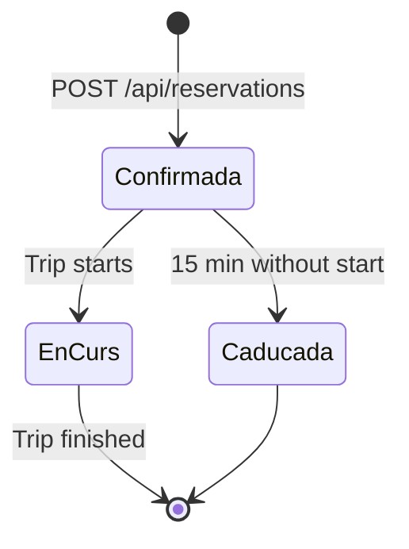

# API

The EcoRide server will expose a REST API with JSON. All routes start from the base URL `https://api.ecoride.example/api` and require an authenticated user, except sign-up and login.

The four planned routes are documented below. The sample responses are made up, but consistent with the project data.

## GET /api/stations

**Purpose:** list the available stations with their location and current occupancy.

**Sample response:**

```json
[
  {
    "id": 12,
    "nom": "Estació Centre",
    "adreca": "Plaça de l'Ajuntament, 1",
    "latitud": 39.4699,
    "longitud": -0.3763,
    "activa": true,
    "bicicletesDisponibles": 8,
    "placesLliures": 4
  },
  {
    "id": 15,
    "nom": "Estació Estació Nord",
    "adreca": "Carrer de Xàtiva, 24",
    "latitud": 39.4667,
    "longitud": -0.3778,
    "activa": true,
    "bicicletesDisponibles": 3,
    "placesLliures": 9
  }
]
```

## GET /api/bikes

**Purpose:** check the bikes and their status. Results can be filtered by station with the `?estacioId=12` parameter.

**Sample response:**

```json
[
  {
    "id": 103,
    "model": "EcoCity 2",
    "tipus": "electrica",
    "estat": "disponible",
    "estacioId": 12,
    "bateria": 87
  },
  {
    "id": 104,
    "model": "EcoCity 2",
    "tipus": "mecanica",
    "estat": "en_us",
    "estacioId": null,
    "bateria": null
  }
]
```

## POST /api/reservations

**Purpose:** create a reservation for the authenticated user. The reservation expires automatically if the trip does not start within 15 minutes.

**Request body (sample):**

```json
{
  "usuariId": 45,
  "bicicletaId": 103,
  "estacioIniciId": 12
}
```

**Sample response (201 Created):**

```json
{
  "id": 987,
  "estat": "confirmada",
  "usuariId": 45,
  "bicicletaId": 103,
  "estacioIniciId": 12,
  "dataCreacio": "2026-11-09T17:30:00",
  "caducaA": "2026-11-09T17:45:00"
}
```

### Reservation states



!!! note "Response codes"
    `201 Created` when the reservation is created, `400 Bad Request` when required fields are missing and `409 Conflict` when the bike already has an active reservation.

## GET /api/users/{id}

**Purpose:** read a user's public data and the number of active reservations.

**Sample response:**

```json
{
  "id": 45,
  "nom": "Laia Ferrer",
  "correu": "laia.ferrer@example.com",
  "actiu": true,
  "reservesActives": 1,
  "co2EstalviatKg": 12.4
}
```
