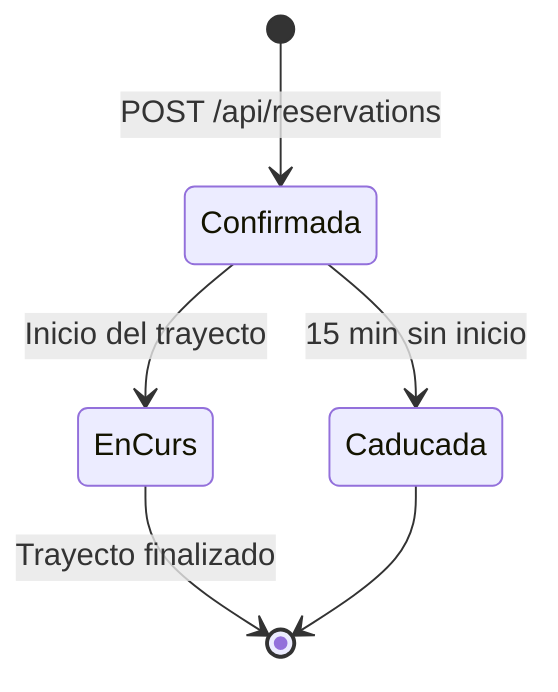

# API

El servidor de EcoRide expondrá una API REST con JSON. Todas las rutas parten de la URL base `https://api.ecoride.example/api` y requieren un usuario autenticado, excepto el registro y el acceso.

A continuación se documentan las cuatro rutas previstas. Los ejemplos de respuesta son inventados, pero coherentes con los datos del proyecto.

## GET /api/stations

**Finalidad:** listar las estaciones disponibles con su ubicación y la ocupación actual.

**Respuesta de ejemplo:**

```json
[
  {
    "id": 12,
    "nom": "Estació Centre",
    "adreca": "Plaça de l'Ajuntament, 1",
    "latitud": 39.4699,
    "longitud": -0.3763,
    "activa": true,
    "bicicletesDisponibles": 8,
    "placesLliures": 4
  },
  {
    "id": 15,
    "nom": "Estació Estació Nord",
    "adreca": "Carrer de Xàtiva, 24",
    "latitud": 39.4667,
    "longitud": -0.3778,
    "activa": true,
    "bicicletesDisponibles": 3,
    "placesLliures": 9
  }
]
```

## GET /api/bikes

**Finalidad:** consultar las bicicletas y su estado. Se puede filtrar por estación con el parámetro `?estacioId=12`.

**Respuesta de ejemplo:**

```json
[
  {
    "id": 103,
    "model": "EcoCity 2",
    "tipus": "electrica",
    "estat": "disponible",
    "estacioId": 12,
    "bateria": 87
  },
  {
    "id": 104,
    "model": "EcoCity 2",
    "tipus": "mecanica",
    "estat": "en_us",
    "estacioId": null,
    "bateria": null
  }
]
```

## POST /api/reservations

**Finalidad:** crear una reserva de una bicicleta para el usuario autenticado. La reserva caduca automáticamente si no se inicia el trayecto en 15 minutos.

**Cuerpo de la petición (ejemplo):**

```json
{
  "usuariId": 45,
  "bicicletaId": 103,
  "estacioIniciId": 12
}
```

**Respuesta de ejemplo (201 Created):**

```json
{
  "id": 987,
  "estat": "confirmada",
  "usuariId": 45,
  "bicicletaId": 103,
  "estacioIniciId": 12,
  "dataCreacio": "2026-11-09T17:30:00",
  "caducaA": "2026-11-09T17:45:00"
}
```

### Estados de una reserva



!!! note "Códigos de respuesta"
    `201 Created` si la reserva se crea correctamente, `400 Bad Request` si faltan campos obligatorios y `409 Conflict` si la bicicleta ya tiene una reserva activa.

## GET /api/users/{id}

**Finalidad:** consultar los datos públicos de un usuario y el número de reservas activas.

**Respuesta de ejemplo:**

```json
{
  "id": 45,
  "nom": "Laia Ferrer",
  "correu": "laia.ferrer@example.com",
  "actiu": true,
  "reservesActives": 1,
  "co2EstalviatKg": 12.4
}
```
