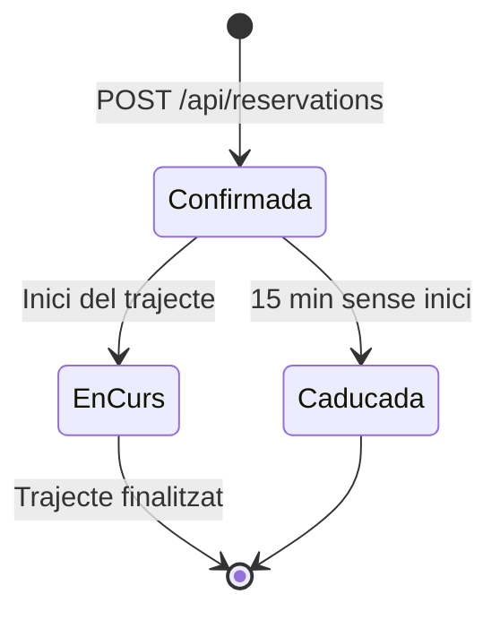

# API

El servidor d'EcoRide exposarà una API REST amb JSON. Totes les rutes parteixen de la URL base `https://api.ecoride.example/api` i requerixen un usuari autenticat, excepte el registre i l'accés.

A continuació es documenten les quatre rutes previstes. Els exemples de resposta són inventats, però coherents amb les dades del projecte.

## GET /api/stations

**Finalitat:** llistar les estacions disponibles amb la seua ubicació i l'ocupació actual.

**Resposta d'exemple:**

```json
[
  {
    "id": 12,
    "nom": "Estació Centre",
    "adreca": "Plaça de l'Ajuntament, 1",
    "latitud": 39.4699,
    "longitud": -0.3763,
    "activa": true,
    "bicicletesDisponibles": 8,
    "placesLliures": 4
  },
  {
    "id": 15,
    "nom": "Estació Estació Nord",
    "adreca": "Carrer de Xàtiva, 24",
    "latitud": 39.4667,
    "longitud": -0.3778,
    "activa": true,
    "bicicletesDisponibles": 3,
    "placesLliures": 9
  }
]
```

## GET /api/bikes

**Finalitat:** consultar les bicicletes i el seu estat. Es pot filtrar per estació amb el paràmetre `?estacioId=12`.

**Resposta d'exemple:**

```json
[
  {
    "id": 103,
    "model": "EcoCity 2",
    "tipus": "electrica",
    "estat": "disponible",
    "estacioId": 12,
    "bateria": 87
  },
  {
    "id": 104,
    "model": "EcoCity 2",
    "tipus": "mecanica",
    "estat": "en_us",
    "estacioId": null,
    "bateria": null
  }
]
```

## POST /api/reservations

**Finalitat:** crear una reserva d'una bicicleta per a l'usuari autenticat. La reserva caduca automàticament si no s'inicia el trajecte en 15 minuts.

**Cos de la petició (exemple):**

```json
{
  "usuariId": 45,
  "bicicletaId": 103,
  "estacioIniciId": 12
}
```

**Resposta d'exemple (201 Created):**

```json
{
  "id": 987,
  "estat": "confirmada",
  "usuariId": 45,
  "bicicletaId": 103,
  "estacioIniciId": 12,
  "dataCreacio": "2026-11-09T17:30:00",
  "caducaA": "2026-11-09T17:45:00"
}
```

### Estats d'una reserva



!!! note "Codis de resposta"
    `201 Created` si la reserva es crea correctament, `400 Bad Request` si falten camps obligatoris i `409 Conflict` si la bicicleta ja té una reserva activa.

## GET /api/users/{id}

**Finalitat:** consultar les dades públiques d'un usuari i el nombre de reserves actives.

**Resposta d'exemple:**

```json
{
  "id": 45,
  "nom": "Laia Ferrer",
  "correu": "laia.ferrer@example.com",
  "actiu": true,
  "reservesActives": 1,
  "co2EstalviatKg": 12.4
}
```
