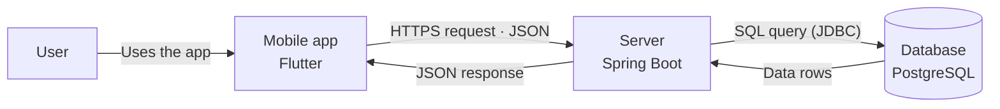
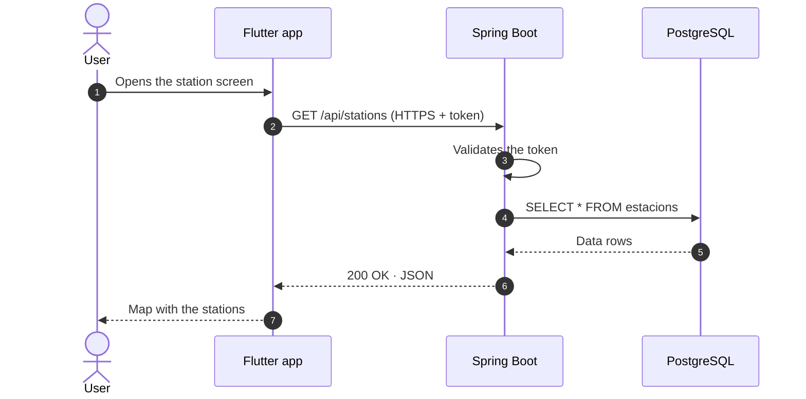

# Architecture

EcoRide is a three-layer application: a mobile client, a server with the business logic and a relational database. Each layer has a specific responsibility and talks to the next one through a defined interface.

## Flutter: the presentation layer

Flutter is the framework used to build the mobile app. It renders the interface (station map, bike list, reservation screen and history), validates the data entered by the user and manages the session. It does not store business data: it only requests information from the server and displays the response.

## Spring Boot: the logic and API layer

Spring Boot is the Java server that exposes the REST API. It receives HTTP requests from the app, checks that the user is authenticated, applies the business rules (for example, that a bike cannot have two active reservations) and decides which data must be read or written. It also converts the data to JSON before returning it to the client.

## PostgreSQL: the persistence layer

PostgreSQL is the database where users, stations, bikes, reservations and trips are stored permanently. The server accesses it through SQL statements and transactions, so critical operations (such as creating a reservation) happen atomically.

## Component diagram

## Request path

When a user opens the station screen, the Flutter app sends a `GET /api/stations` request to the Spring Boot server over HTTPS. Spring Boot receives the request, checks the authentication token, runs the corresponding SQL query through JDBC against PostgreSQL and receives the rows from the stations table. The server then turns those rows into a JSON array and returns it as an HTTP response. Finally, Flutter deserialises the JSON and draws the stations on the map, so the user sees the information without knowing anything about the database.

## Sequence diagram

The following diagram shows the same path, but with the chronological order of messages between the four participants.

The authentication token travels in the `Authorization: Bearer <token>` header of every request; if the server cannot validate it, it responds with `401 Unauthorized` and never queries the database.
