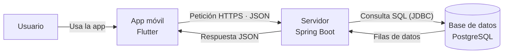
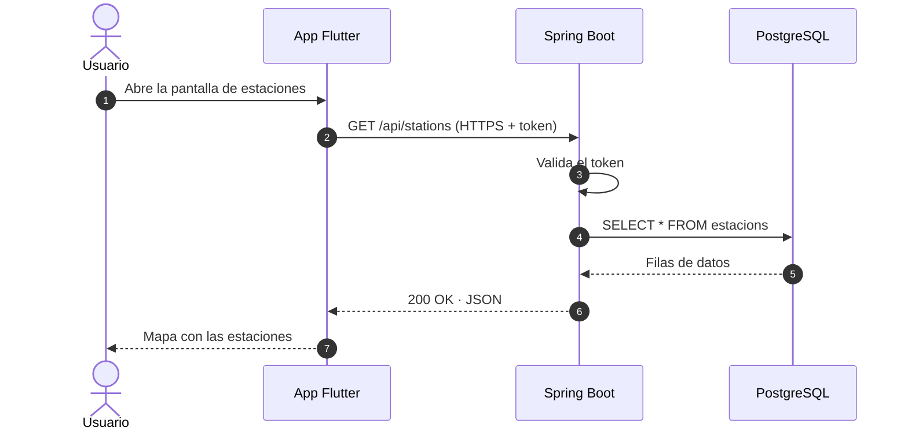

# Arquitectura

EcoRide es una aplicación en tres capas: un cliente móvil, un servidor con la lógica de negocio y una base de datos relacional. Cada capa tiene una responsabilidad concreta y se comunica con la siguiente a través de una interfaz definida.

## Flutter: la capa de presentación

Flutter es el framework con el que se construye la aplicación móvil. Se encarga de mostrar la interfaz (mapa de estaciones, listado de bicicletas, pantalla de reservas e historial), de validar los datos que introduce el usuario y de gestionar la sesión. No guarda datos del negocio: solo pide información al servidor y presenta la respuesta.

## Spring Boot: la capa de lógica y API

Spring Boot es el servidor de Java que expone la API REST. Recibe las peticiones HTTP de la app, comprueba que el usuario está autenticado, aplica las reglas del negocio (por ejemplo, que una bicicleta no pueda tener dos reservas activas) y decide qué datos hay que leer o escribir. También convierte los datos a JSON para devolverlos al cliente.

## PostgreSQL: la capa de persistencia

PostgreSQL es la base de datos donde se guardan de forma permanente los usuarios, las estaciones, las bicicletas, las reservas y los trayectos. El servidor accede mediante sentencias SQL y transacciones, de modo que las operaciones críticas (como crear una reserva) se hacen de forma atómica.

## Diagrama de componentes

## Recorrido de una petición

Cuando un usuario abre la pantalla de estaciones, la app de Flutter envía una petición `GET /api/stations` al servidor de Spring Boot mediante HTTPS. Spring Boot recibe la petición, comprueba el token de autenticación, ejecuta la consulta SQL correspondiente a través de JDBC contra PostgreSQL y recibe las filas de la tabla de estaciones. A continuación, el servidor convierte esas filas en un array JSON y lo devuelve como respuesta HTTP. Por último, Flutter deserializa el JSON y dibuja las estaciones en el mapa, de modo que el usuario ve la información sin saber nada de la base de datos.

## Diagrama de secuencia

El siguiente diagrama muestra el mismo recorrido, pero con el orden temporal de los mensajes entre los cuatro participantes.

El token de autenticación viaja en la cabecera `Authorization: Bearer <token>` de cada petición; si el servidor no puede validarlo, responde con un `401 Unauthorized` y no llega a consultar la base de datos.
