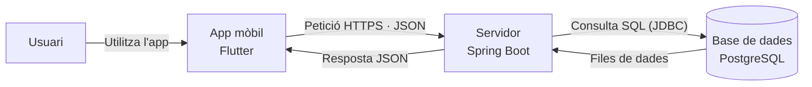
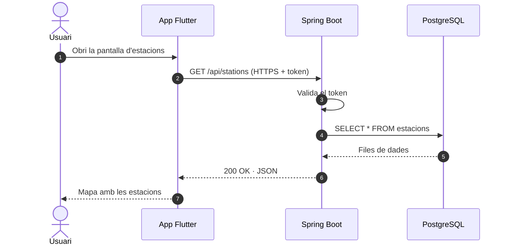

# Arquitectura

EcoRide és una aplicació en tres capes: un client mòbil, un servidor amb la lògica de negoci i una base de dades relacional. Cada capa té una responsabilitat concreta i es comunica amb la següent a través d'una interfície definida.

## Flutter: la capa de presentació

Flutter és el framework amb què es construïx l'aplicació mòbil. S'encarrega de mostrar la interfície (mapa d'estacions, llistat de bicicletes, pantalla de reserves i historial), de validar les dades que introdueix l'usuari i de gestionar la sessió. No guarda dades del negoci: només demana informació al servidor i presenta la resposta.

## Spring Boot: la capa de lògica i API

Spring Boot és el servidor de Java que exposa l'API REST. Rep les peticions HTTP de l'app, comprova que l'usuari està autenticat, aplica les regles del negoci (per exemple, que una bicicleta no puga tindre dues reserves actives) i decidix quines dades cal llegir o escriure. També convertix les dades a JSON per a retornar-les al client.

## PostgreSQL: la capa de persistència

PostgreSQL és la base de dades on es guarden de manera permanent els usuaris, les estacions, les bicicletes, les reserves i els trajectes. El servidor hi accedix mitjançant sentències SQL i transaccions, de manera que les operacions crítiques (com crear una reserva) es fan de manera atòmica.

## Diagrama de components

## Recorregut d'una petició

Quan un usuari obri la pantalla d'estacions, l'app de Flutter envia una petició `GET /api/stations` al servidor de Spring Boot mitjançant HTTPS. Spring Boot rep la petició, comprova el token d'autenticació, executa la consulta SQL corresponent a través de JDBC contra PostgreSQL i rep les files de la taula d'estacions. A continuació, el servidor convertix eixes files en un array JSON i el retorna com a resposta HTTP. Finalment, Flutter deserialitza el JSON i dibuixa les estacions al mapa, de manera que l'usuari veu la informació sense saber res de la base de dades.

## Diagrama de seqüència

El diagrama següent mostra el mateix recorregut, però amb l'ordre temporal dels missatges entre els quatre participants.

El token d'autenticació viatja a la capçalera `Authorization: Bearer <token>` de cada petició; si el servidor no el pot validar, respon amb un `401 Unauthorized` i no arriba a consultar la base de dades.
