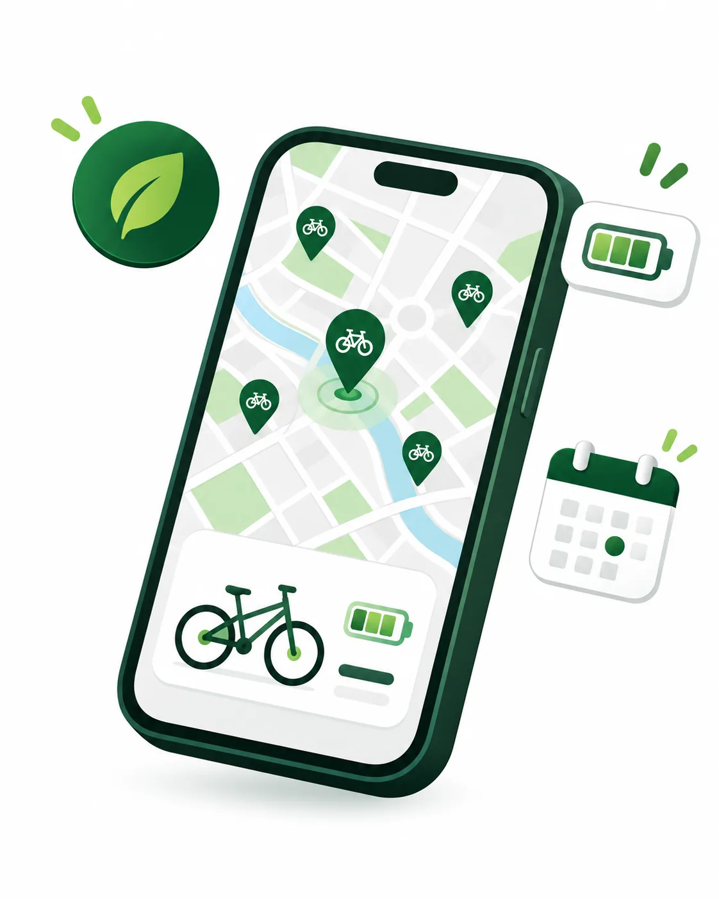

# Features

EcoRide groups its features into four main blocks. For each one, the page explains what the user can do and who it is aimed at.

<figure class="eco-figure eco-figure--portrait" markdown>
{ loading=lazy decoding=async width=1122 height=1402 }
<figcaption>The app shows nearby stations, free bikes and their status on the map.</figcaption>
</figure>

## 1. User sign-up and login

**What it allows:** creating an account with a name, email address and password, logging in and keeping the session open on the phone. It also allows password recovery and account deletion.

**Who uses it:** anyone who wants to become a service user; without an account, reservations are not possible.

## 2. Station and bike lookup

**What it allows:** seeing nearby stations on the map, checking how many bikes and docks each one has, and opening the details of a specific bike (model, status and battery level if it is electric).

**Who uses it:** riders, before setting off or to decide which station to walk to.

## 3. Bike reservations

**What it allows:** reserving a specific bike at a station for a limited time, cancelling the reservation and starting the trip when the user picks the bike up.

**Who uses it:** registered users who want to make sure a bike is available before reaching the station.

## 4. Trip history and CO₂ savings

**What it allows:** reviewing past trips, their duration, distance and cost, as well as an estimate of the CO₂ avoided by replacing a car with a bike.

**Who uses it:** registered users checking their activity, and the administration team for service usage statistics.

## Summary and status

| Feature | Main user | Status |
| --- | --- | --- |
| User sign-up and login | Rider | In development |
| Station and bike lookup | Rider | In development |
| Bike reservations | Registered user | Planned |
| Trip history and CO₂ savings | Registered user / administration | Planned |

!!! tip "Next sprint priority"
    The two features **in development** are the foundation for the rest: without user registration there can be no reservations and no history.
