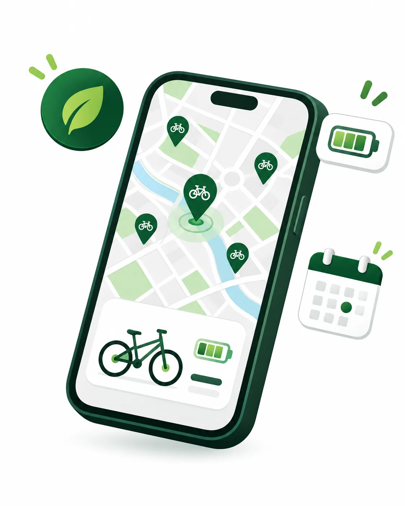

# Funcionalidades

EcoRide agrupa sus funcionalidades en cuatro bloques principales. Para cada uno se indica qué permite hacer al usuario y a quién va dirigido.

<figure class="eco-figure eco-figure--portrait" markdown>

<figcaption>La app muestra en el mapa las estaciones cercanas, las bicicletas libres y su estado.</figcaption>
</figure>

## 1. Registro y acceso de usuarios

**Qué permite hacer:** crear una cuenta con nombre, correo electrónico y contraseña, iniciar sesión y mantener la sesión abierta en el móvil. También permite recuperar la contraseña y darse de baja.

**Quién la utiliza:** cualquier persona que quiera ser usuaria del servicio; sin cuenta no se pueden hacer reservas.

## 2. Consulta de estaciones y bicicletas disponibles

**Qué permite hacer:** ver en el mapa las estaciones cercanas, saber cuántas bicicletas libres y cuántas plazas de aparcamiento tiene cada una, y abrir el detalle de una bicicleta concreta (modelo, estado y nivel de batería si es eléctrica).

**Quién la utiliza:** el pasajero, antes de desplazarse o para decidir a qué estación ir.

## 3. Reservas de bicicletas

**Qué permite hacer:** reservar una bicicleta concreta en una estación durante un tiempo limitado, cancelar la reserva e iniciar el trayecto cuando el usuario recoge la bicicleta.

**Quién la utiliza:** el usuario registrado que quiere asegurarse una bicicleta disponible antes de llegar a la estación.

## 4. Historial de trayectos y ahorro de CO₂

**Qué permite hacer:** consultar los trayectos hechos, la duración, la distancia y el coste de cada uno, así como la estimación del CO₂ que se ha dejado de emitir al sustituir un coche por la bicicleta.

**Quién la utiliza:** el usuario registrado para revisar su actividad, y el equipo de administración para obtener estadísticas de uso del servicio.

## Resumen y estado

| Funcionalidad | Usuario principal | Estado |
| --- | --- | --- |
| Registro y acceso de usuarios | Pasajero | En desarrollo |
| Consulta de estaciones y bicicletas | Pasajero | En desarrollo |
| Reservas de bicicletas | Usuario registrado | Prevista |
| Historial de trayectos y ahorro de CO₂ | Usuario registrado / administración | Prevista |

!!! tip "Prioridad del próximo sprint"
    Las dos funcionalidades **en desarrollo** son la base del resto: sin registro de usuarios no se pueden crear reservas ni guardar el historial.
