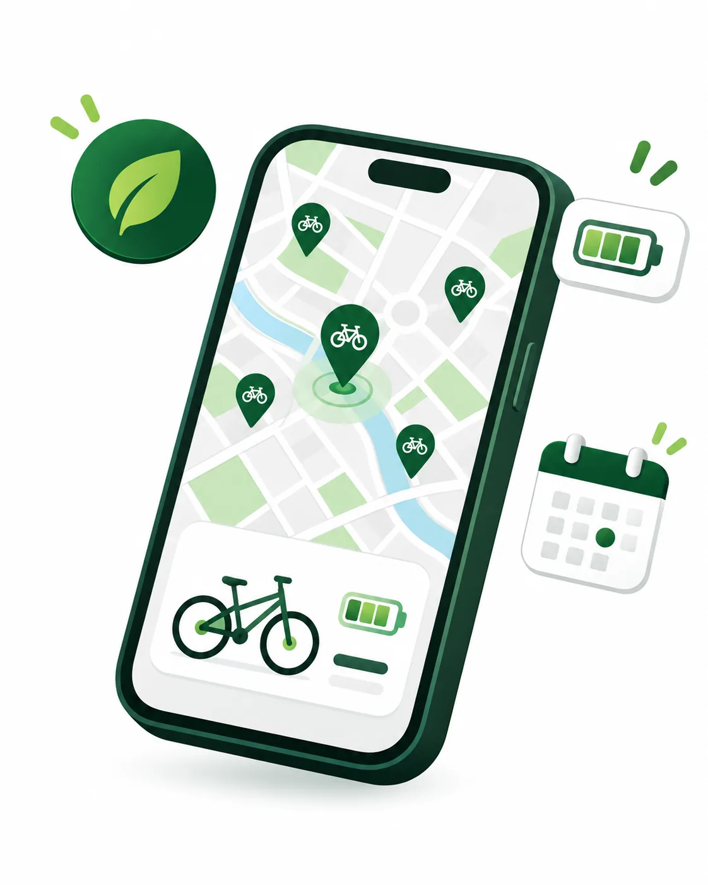

# Funcionalitats

EcoRide agrupa les seues funcionalitats en quatre blocs principals. Per a cadascun s'indica què permet fer a l'usuari i a qui va dirigit.

<figure class="eco-figure eco-figure--portrait" markdown>

<figcaption>La app mostra al mapa les estacions properes, les bicicletes lliures i el seu estat.</figcaption>
</figure>

## 1. Registre i accés d'usuaris

**Què permet fer:** crear un compte amb nom, correu electrònic i contrasenya, iniciar sessió i mantindre la sessió oberta al mòbil. També permet recuperar la contrasenya i donar-se de baixa.

**Qui la utilitza:** qualsevol persona que vulga ser usuària del servei; sense compte no es poden fer reserves.

## 2. Consulta d'estacions i bicicletes disponibles

**Què permet fer:** veure al mapa les estacions properes, saber quantes bicicletes lliures i quantes places d'aparcament té cadascuna, i obrir el detall d'una bicicleta concreta (model, estat i nivell de bateria si és elèctrica).

**Qui la utilitza:** el passatger, abans de desplaçar-se o per a decidir a quina estació anar.

## 3. Reserves de bicicletes

**Què permet fer:** reservar una bicicleta concreta en una estació durant un temps limitat, cancel·lar la reserva i iniciar el trajecte quan l'usuari arreplega la bicicleta.

**Qui la utilitza:** l'usuari registrat que vol assegurar-se una bicicleta disponible abans d'arribar a l'estació.

## 4. Historial de trajectes i estalvi de CO₂

**Què permet fer:** consultar els trajectes fets, la durada, la distància i el cost de cadascun, així com l'estimació del CO₂ que s'ha deixat d'emetre en substituir un cotxe per la bicicleta.

**Qui la utilitza:** l'usuari registrat per a revisar la seua activitat, i l'equip d'administració per a obtindre estadístiques d'ús del servei.

## Resum i estat

| Funcionalitat | Usuari principal | Estat |
| --- | --- | --- |
| Registre i accés d'usuaris | Passatger | En desenvolupament |
| Consulta d'estacions i bicicletes | Passatger | En desenvolupament |
| Reserves de bicicletes | Usuari registrat | Prevista |
| Historial de trajectes i estalvi de CO₂ | Usuari registrat / administració | Prevista |

!!! tip "Prioritat del proper sprint"
    Les dues funcionalitats **en desenvolupament** són la base de la resta: sense registre d'usuaris no es poden crear reserves ni guardar l'historial.
