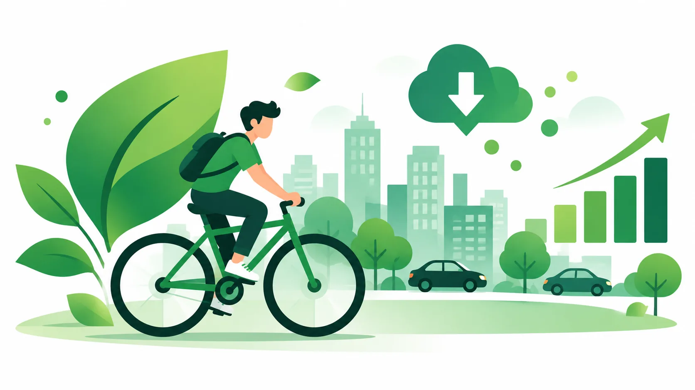

2nd DAM · Intermodular project

<h1 class="eco-hero__title">EcoRide</h1>

Move different, move sustainable.

<a class="md-button md-button--primary" href="funcionalitats/">See features</a><a class="md-button" href="instalacio/">Installation guide</a>

<ul class="eco-chips"><li>Flutter</li><li>Spring Boot</li><li>PostgreSQL</li><li>REST · JSON</li></ul>

EcoRide is a fictional bike-sharing app designed for cities. It lets people check available stations, reserve a bike and review completed trips from their phone, quickly and easily. The project aims to reduce private traffic and CO₂ emissions while offering an affordable mobility alternative for citizens. This documentation explains what the app does, how it is organised technically and which services it will provide, so any developer can join the team with a clear view of the whole system and its components.

## Main goal

EcoRide's main goal is to make sustainable urban mobility easy: anyone should be able to pick up a bike at one station, ride to another and leave it there, without owning a bike.

## Benefits of shared mobility

1. **Environmental sustainability**: every bike trip replaces a private car journey and cuts CO₂ emissions and noise pollution.
2. **Economic savings**: users pay only for the trips they make, with no cost of buying, maintaining and insuring a bike.
3. **Health and wellbeing**: daily physical activity improves cardiovascular fitness and reduces the stress of urban commuting.
4. **Less traffic and more public space**: more shared bikes means fewer cars, fewer jams and more room for people.

<figure class="eco-figure" markdown>
{ loading=lazy decoding=async width=1672 height=941 }
<figcaption>Every shared trip reduces traffic, noise and the city's CO₂ emissions.</figcaption>
</figure>

## Planned features

-   :material-account-circle:{ .lg .middle } **Sign-up and login**

    ---

    Create your account, log in and manage your profile.

-   :material-map-marker:{ .lg .middle } **Station lookup**

    ---

    Map with stations, free bikes and available docks.

-   :material-bike:{ .lg .middle } **Available bikes**

    ---

    Status, model and battery of every bike in real time.

-   :material-calendar-check:{ .lg .middle } **Reservations**

    ---

    Reserve a specific bike and cancel it if your plans change.

-   :material-history:{ .lg .middle } **Trip history**

    ---

    Duration, distance and cost of every completed trip.

-   :material-leaf:{ .lg .middle } **CO₂ savings**

    ---

    An estimate of the emissions you avoided.

## Where to go next

[See features](funcionalitats.en.md){ .md-button } [Installation guide](instalacio.en.md){ .md-button .md-button--primary }
