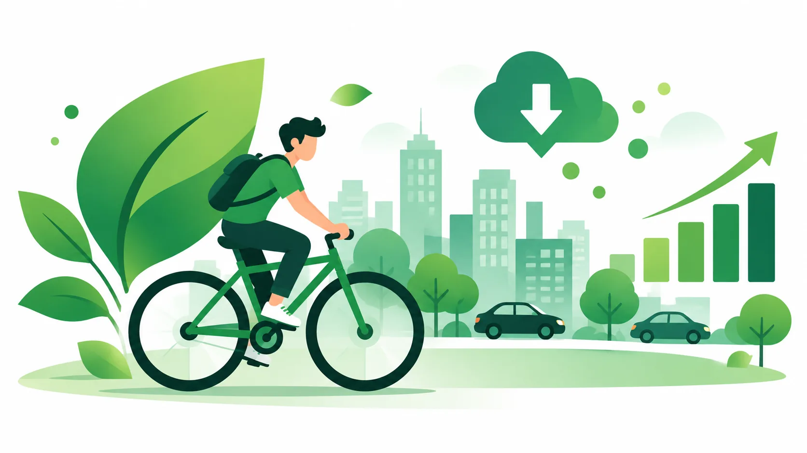

2n DAM · Proyecto intermodular

<h1 class="eco-hero__title">EcoRide</h1>

Muévete distinto, muévete sostenible.

<a class="md-button md-button--primary" href="funcionalitats/">Ver funcionalidades</a><a class="md-button" href="instalacio/">Guía de instalación</a>

<ul class="eco-chips"><li>Flutter</li><li>Spring Boot</li><li>PostgreSQL</li><li>REST · JSON</li></ul>

EcoRide es una aplicación ficticia de bicicletas compartidas pensada para las ciudades. Permite consultar las estaciones disponibles, reservar una bicicleta y revisar los trayectos realizados desde el móvil, de forma rápida y sencilla. El proyecto quiere reducir el tráfico privado y las emisiones de CO₂, a la vez que ofrece una alternativa de movilidad asequible para la ciudadanía. Esta documentación recoge qué hace la aplicación, cómo se organiza técnicamente y qué servicios ofrecerá, para que cualquier desarrollador pueda incorporarse al equipo con una visión clara del conjunto y de sus componentes.

## Objetivo principal

El objetivo principal de EcoRide es facilitar la movilidad urbana sostenible: que cualquier persona pueda coger una bicicleta en una estación, desplazarse hasta otra y dejarla allí, sin necesidad de tener una en propiedad.

## Ventajas de la movilidad compartida

1. **Sostenibilidad ambiental**: cada viaje en bicicleta sustituye un desplazamiento en vehículo privado y reduce las emisiones de CO₂ y la contaminación acústica.
2. **Ahorro económico**: el usuario paga solo por los viajes que hace, sin asumir el coste de comprar, mantener y asegurar una bicicleta.
3. **Salud y bienestar**: la actividad física diaria mejora la condición cardiovascular y reduce el estrés de los desplazamientos urbanos.
4. **Menos tráfico y más espacio público**: más bicicletas compartidas significa menos coches, menos atascos y más espacio para las personas.

<figure class="eco-figure" markdown>

<figcaption>Cada trayecto compartido reduce el tráfico, el ruido y las emisiones de CO₂ de la ciudad.</figcaption>
</figure>

## Funcionalidades previstas

-   :material-account-circle:{ .lg .middle } **Registro y acceso**

    ---

    Crea tu cuenta, inicia sesión y gestiona tu perfil.

-   :material-map-marker:{ .lg .middle } **Consulta de estaciones**

    ---

    Mapa con estaciones, bicicletas libres y plazas disponibles.

-   :material-bike:{ .lg .middle } **Bicicletas disponibles**

    ---

    Estado, modelo y batería de cada bicicleta en tiempo real.

-   :material-calendar-check:{ .lg .middle } **Reservas**

    ---

    Reserva una bicicleta concreta y cancélala si cambia el plan.

-   :material-history:{ .lg .middle } **Historial de trayectos**

    ---

    Duración, distancia y coste de todos los viajes realizados.

-   :material-leaf:{ .lg .middle } **Ahorro de CO₂**

    ---

    Estimación de las emisiones que has dejado de emitir.

## Por dónde continuar

[Ver funcionalidades](funcionalitats.es.md){ .md-button } [Guía de instalación](instalacio.es.md){ .md-button .md-button--primary }
