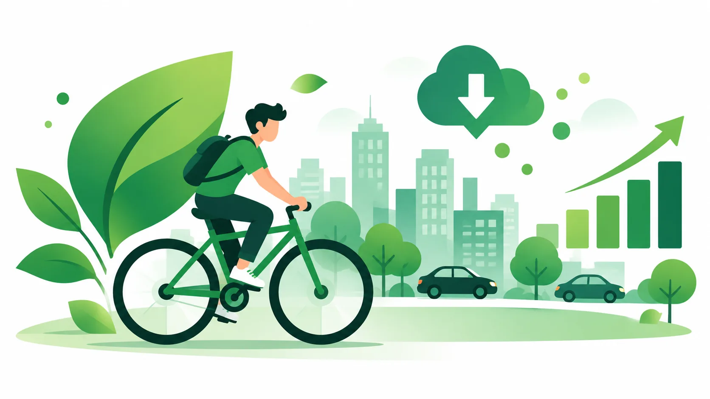

2n DAM · Projecte intermodular

<h1 class="eco-hero__title">EcoRide</h1>

Mou-te diferent, mou-te sostenible.

<a class="md-button md-button--primary" href="funcionalitats/">Veure funcionalitats</a><a class="md-button" href="instalacio/">Guia d'instal·lació</a>

<ul class="eco-chips"><li>Flutter</li><li>Spring Boot</li><li>PostgreSQL</li><li>REST · JSON</li></ul>

EcoRide és una aplicació fictícia de bicicletes compartides pensada per a les ciutats. Permet consultar les estacions disponibles, reservar una bicicleta i revisar els trajectes realitzats des del mòbil, de manera ràpida i senzilla. El projecte vol reduir el trànsit privat i les emissions de CO₂, alhora que ofereix una alternativa de mobilitat assequible per a la ciutadania. Aquesta documentació recull què fa l'aplicació, com s'organitza tècnicament i quins serveis oferirà, perquè qualsevol desenvolupador puga incorporar-se a l'equip amb una visió clara del conjunt i dels seus components.

## Objectiu principal

L'objectiu principal d'EcoRide és facilitar la mobilitat urbana sostenible: que qualsevol persona puga agafar una bicicleta en una estació, desplaçar-se fins a una altra i deixar-la allà, sense necessitat de tindre'n una en propietat.

## Avantatges de la mobilitat compartida

1. **Sostenibilitat ambiental**: cada viatge en bicicleta substitueix un desplaçament en vehicle privat i reduix les emissions de CO₂ i la contaminació acústica.
2. **Estalvi econòmic**: l'usuari paga només pels viatges que fa, sense assumir el cost de comprar, mantindre i assegurar una bicicleta.
3. **Salut i benestar**: l'activitat física diària millora la condició cardiovascular i reduix l'estrés dels desplaçaments urbans.
4. **Menys trànsit i més espai públic**: més bicicletes compartides significa menys cotxes, menys embossos i més espai per a les persones.

<figure class="eco-figure" markdown>

<figcaption>Cada trajecte compartit reduix el trànsit, el soroll i les emissions de CO₂ de la ciutat.</figcaption>
</figure>

## Funcionalitats previstes

-   :material-account-circle:{ .lg .middle } **Registre i accés**

    ---

    Crea el teu compte, inicia sessió i gestiona el teu perfil.

-   :material-map-marker:{ .lg .middle } **Consulta d'estacions**

    ---

    Mapa amb estacions, bicicletes lliures i places disponibles.

-   :material-bike:{ .lg .middle } **Bicicletes disponibles**

    ---

    Estat, model i bateria de cada bicicleta en temps real.

-   :material-calendar-check:{ .lg .middle } **Reserves**

    ---

    Reserva una bicicleta concreta i cancel·la-la si canvia el pla.

-   :material-history:{ .lg .middle } **Historial de trajectes**

    ---

    Durada, distància i cost de tots els viatges realitzats.

-   :material-leaf:{ .lg .middle } **Estalvi de CO₂**

    ---

    Estimació de les emissions que has deixat d'emetre.

## Per on continuar

[Veure funcionalitats](funcionalitats.md){ .md-button } [Guia d'instal·lació](instalacio.md){ .md-button .md-button--primary }
