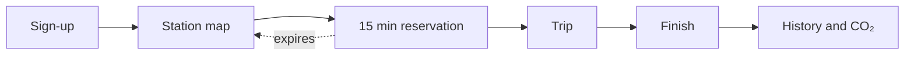

# User manual

This manual walks through the full journey of someone using EcoRide for the first time: from signing up to checking their latest trip. The steps describe the mobile app once it is finished; features that are not implemented yet are marked in [Features](funcionalitats.en.md).

## 1. Create an account

1. Open the app and tap **Sign up**.
2. Enter your name, a valid email address and a password of at least eight characters.
3. Accept the terms of service and confirm your email from the link you receive.

!!! note "Email verification"
    Without a verified email the account stays *pending* and reservations are blocked. Verification expires after seven days.

## 2. Find a station

The map shows stations within 500 metres of your position, sorted by distance. Each marker shows how many free bikes and free docks are left.

!!! tip "Full stations"
    If a station has no free docks, the app suggests the nearest one with availability before letting you start the reservation.

## 3. Reserve a bike

1. Tap the station marker and choose a bike from the list.
2. Check the model, the range (if it is electric) and the status.
3. Confirm the reservation: the bike is locked for **15 minutes**.
4. If you do not arrive in time, the reservation expires and the bike becomes available again.

## 4. Take the trip

Unlock the bike with the code on screen and ride. The app records the start, distance and duration in the background. When you arrive, leave the bike at a station with free docks and tap **Finish**.

## 5. Check your history

Under **My account → Trips** you will find the duration, distance, cost and CO₂ saved for each ride. The data can be exported as CSV.

## Service limits

| Item | Value | What happens if exceeded |
| --- | --- | --- |
| Reservation duration | 15 minutes | The reservation expires automatically |
| Trip duration | 2 hours | An extra per-minute fee applies |
| Bikes per user | 1 at a time | The current trip must end before reserving another |
| Minimum distance counted for CO₂ | 100 metres | The trip adds no environmental savings |

## Flow summary

For any question about how it works, check the [FAQ](faq.en.md) or look at the services behind each screen in the [API reference](api.en.md).
