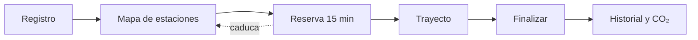

# Manual de usuario

Este manual describe el recorrido completo de una persona que utiliza EcoRide por primera vez: desde el registro hasta la consulta del último trayecto. Los pasos son los que tendrá la aplicación móvil cuando esté acabada; las funcionalidades que todavía no están implementadas se indican en [Funcionalidades](funcionalitats.es.md).

## 1. Crear la cuenta

1. Abre la aplicación y pulsa **Registrarse**.
2. Introduce el nombre, un correo electrónico válido y una contraseña de ocho caracteres como mínimo.
3. Acepta las condiciones del servicio y confirma el correo desde el enlace que recibirás.

!!! note "Verificación del correo"
    Sin el correo verificado la cuenta queda en estado *pendiente* y no se pueden hacer reservas. La verificación caduca a los siete días.

## 2. Encontrar una estación

El mapa muestra las estaciones a menos de 500 metros de tu posición, ordenadas por distancia. Cada marcador indica cuántas bicicletas libres y cuántas plazas de aparcamiento quedan.

!!! tip "Estaciones llenas"
    Si una estación no tiene plazas libres, la aplicación te propone la más cercana con disponibilidad antes de dejarte iniciar la reserva.

## 3. Reservar una bicicleta

1. Toca el marcador de la estación y elige una bicicleta del listado.
2. Revisa el modelo, la autonomía (si es eléctrica) y el estado.
3. Confirma la reserva: la bicicleta queda bloqueada durante **15 minutos**.
4. Si no llegas a tiempo, la reserva caduca y la bicicleta vuelve a estar disponible.

## 4. Hacer el trayecto

Desbloquea la bicicleta con el código de la pantalla y pedalea. La aplicación registra el inicio, la distancia y la duración en segundo plano. Al llegar, deja la bicicleta en una estación con plazas y pulsa **Finalizar**.

## 5. Consultar el historial

En **Mi cuenta → Trayectos** encontrarás la duración, la distancia, el coste y el CO₂ ahorrado de cada viaje. Los datos se pueden exportar en CSV.

## Límites del servicio

| Concepto | Valor | Qué pasa si se supera |
| --- | --- | --- |
| Duración de la reserva | 15 minutos | La reserva caduca automáticamente |
| Duración de un trayecto | 2 horas | Se aplica una tarifa extra por minuto |
| Bicicletas por usuario | 1 simultánea | Hay que finalizar la actual para reservar otra |
| Distancia mínima para contar CO₂ | 100 metros | El trayecto no suma ahorro ambiental |

## Resumen del flujo

Para cualquier duda sobre el funcionamiento, consulta las [preguntas frecuentes](faq.es.md) o revisa los servicios que hay detrás de cada pantalla en la [referencia de la API](api.es.md).
