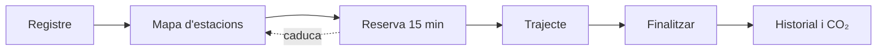

# Manual d'usuari

Aquest manual descriu el recorregut complet d'una persona que utilitza EcoRide per primera vegada: des del registre fins a la consulta del darrer trajecte. Els passos són els que tindrà l'aplicació mòbil quan estiga acabada; les funcionalitats que encara no estan implementades s'indiquen a [Funcionalitats](funcionalitats.md).

## 1. Crear el compte

1. Obri l'aplicació i prem **Registrar-se**.
2. Introduïx el nom, un correu electrònic vàlid i una contrasenya de huit caràcters com a mínim.
3. Accepta les condicions del servei i confirma el correu des de l'enllaç que rebràs.

!!! note "Verificació del correu"
    Sense el correu verificat el compte queda en estat *pendent* i no es poden fer reserves. La verificació caduca als set dies.

## 2. Trobar una estació

El mapa mostra les estacions a menys de 500 metres de la teua posició, ordenades per distància. Cada marcador indica quantes bicicletes lliures i quantes places d'aparcament queden.

!!! tip "Estacions plenes"
    Si una estació no té places lliures, l'aplicació et proposa la més propera amb disponibilitat abans de deixar-te iniciar la reserva.

## 3. Reservar una bicicleta

1. Toca el marcador de l'estació i tria una bicicleta del llistat.
2. Revisa el model, l'autonomia (si és elèctrica) i l'estat.
3. Confirma la reserva: la bicicleta queda bloquejada durant **15 minuts**.
4. Si no arribes a temps, la reserva caduca i la bicicleta torna a estar disponible.

## 4. Fer el trajecte

Desbloqueja la bicicleta amb el codi de la pantalla i pedala. L'aplicació registra l'inici, la distància i la durada en segon pla. En arribar, deixa la bicicleta en una estació amb places i prem **Finalitzar**.

## 5. Consultar l'historial

A **El meu compte → Trajectes** trobaràs la durada, la distància, el cost i el CO₂ estalviat de cada viatge. Les dades es poden exportar en CSV.

## Límits del servei

| Concepte | Valor | Què passa si se supera |
| --- | --- | --- |
| Durada de la reserva | 15 minuts | La reserva caduca automàticament |
| Durada d'un trajecte | 2 hores | S'aplica una tarifa extra per minut |
| Bicicletes per usuari | 1 simultània | Cal finalitzar l'actual per reservar-ne una altra |
| Distància mínima per comptar CO₂ | 100 metres | El trajecte no suma estalvi ambiental |

## Resum del flux

Per a qualsevol dubte sobre el funcionament, consulta les [preguntes freqüents](faq.md) o revisa els serveis que hi ha darrere de cada pantalla a la [referència de l'API](api.md).
